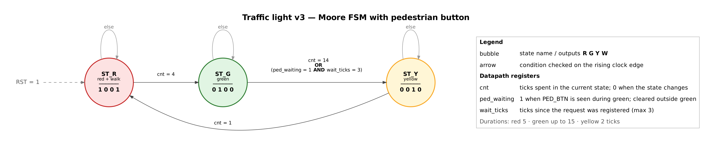

# Traffic Light Controller — VHDL

A simple traffic light controller written in VHDL, built as a learning project
while studying digital design and FPGA development. The design combines a
**finite state machine (FSM)** with a **tick counter**, and is verified with a
simulation testbench.

## Overview

The light cycles through three colors, each lasting a different number of
clock ticks:

| Color  | Duration |
| ------ | -------- |
| Red    | 5 ticks  |
| Green  | 4 ticks  |
| Yellow | 2 ticks  |

Sequence: **Red → Green → Yellow → Red → ...**

An asynchronous, active-high reset returns the light to **red** and restarts
the timing at any moment.

## Interface

| Port  | Direction | Description                           |
| ----- | --------- | ------------------------------------- |
| `CLK` | in        | System clock                          |
| `RST` | in        | Asynchronous reset, active high → red |
| `R`   | out       | Red lamp (1 = on)                     |
| `G`   | out       | Green lamp (1 = on)                   |
| `Y`   | out       | Yellow lamp (1 = on)                  |

## Design

The circuit is split into two cooperating parts:

```
        ┌─────────────┐   TM (tick count)   ┌──────────────┐
        │     FSM     │◄────────────────────│ Tick counter │
        │  (colors)   │                     │   0 → 10     │
        └─────────────┘                     └──────────────┘
               │
               ▼
            R, G, Y
```

### 1. State machine (Moore)

Three states, one per color. Outputs depend only on the current state,
so this is a **Moore** machine.

| State | Color  | Next state | R   | G   | Y   |
| ----- | ------ | ---------- | --- | --- | --- |
| ST0   | Red    | ST1        | 1   | 0   | 0   |
| ST1   | Green  | ST2        | 0   | 1   | 0   |
| ST2   | Yellow | ST0        | 0   | 0   | 1   |


Note: the outputs inside the bubbles are written in **R, Y, G** order
(e.g. `001` = green, `010` = yellow).

On each arrow, `1` means "time is up, move to the next color" and `0` means
"stay in the current color".

### 2. Shared tick counter

Instead of restarting a counter for every color, a single counter `TM` runs
from 0 to 10 and wraps around. Each color owns a fixed range of counter values:

| TM value | 0   | 1   | 2   | 3   | 4   | 5   | 6   | 7   | 8   | 9   | 10  |
| -------- | --- | --- | --- | --- | --- | --- | --- | --- | --- | --- | --- |
| Color    | R   | R   | R   | R   | R   | G   | G   | G   | G   | Y   | Y   |

The FSM leaves a state when `TM` reaches the **last tick** of that color
(`TM = 4`, `8`, `10`). Because the state register and the counter update on
the **same clock edge**, the FSM and the counter always stay in sync: when
yellow ends, the counter wraps to 0 at the same moment the light turns red.

**Why the last tick and not the next one?** The next-state logic only
_plans_ the transition; the state actually changes on the following clock
edge. Using `TM = 5` instead of `TM = 4` would make red last 6 ticks.

### Code structure

The architecture uses three processes, and each signal is driven by exactly
one of them:

| Process        | Type          | Drives              | Role                   |
| -------------- | ------------- | ------------------- | ---------------------- |
| `sync_proc`    | Clocked       | `PS`                | State register         |
| `counter_proc` | Clocked       | `TM`                | Tick counter (0 → 10)  |
| `comb_proc`    | Combinational | `NS`, `R`, `G`, `Y` | Next state and outputs |

Both clocked processes follow the same pattern: asynchronous reset is checked
first, outside the clock edge, and all normal operation happens inside
`rising_edge(CLK)`.

## Simulation

The testbench:

1. Applies an initial reset
2. Lets the light run for more than one full cycle (11 ticks = 110 ns)
3. Asserts reset **while green is on** to check that the asynchronous reset
   immediately returns the light to red and the counter to 0
4. Runs another full cycle to confirm red lasts exactly 5 ticks after reset


The cursor at 95 ns shows a rising clock edge where `TM` goes from 8 to 9 and
the light switches from green to yellow in the same edge.

### Self-checking testbench

`traffic_light_tb_selfcheck.vhd` checks the light automatically with
`assert` statements instead of inspecting the waveform by eye. In the
middle of every clock tick it verifies that exactly one lamp is on and
that it is the expected color. Three full cycles are checked
(33 checks in total).

Passing run:

    tb.vhd:47:9:@340ns:(report note): Test finished

Running the same testbench against the buggy version (the leftover
`NS <= ST0;` line) catches the bug automatically, on every cycle:

    @110ns:(assertion error): Yellow should be on, TM = 10
    @220ns:(assertion error): Yellow should be on, TM = 10
    @330ns:(assertion error): Yellow should be on, TM = 10

### Run it yourself

**EDA Playground:** paste the design and testbench, select VHDL with GHDL,
set the top entity to `my_t_lmb_tb`, and enable _Open EPWave after run_.

**GHDL (locally):**

```bash
ghdl -a v2/traffic_light.vhd v2/traffic_light_tb.vhd
ghdl -e my_t_lmb_tb
ghdl -r my_t_lmb_tb --vcd=wave.vcd
gtkwave wave.vcd
```

## v3 — Pedestrian button

Files: [`v3/traffic_light_v3.vhd`](v3/traffic_light_v3.vhd),
[`v3/traffic_light_v3_tb.vhd`](v3/traffic_light_v3_tb.vhd)

### What changed

v3 models a mid-block pedestrian crossing. A pedestrian can press a button
to shorten the green light for cars. When the car light is red, pedestrians
are allowed to walk.

| Port          | Direction | Description                                          |
| ------------- | --------- | ---------------------------------------------------- |
| `CLK`         | in        | System clock                                         |
| `RST`         | in        | Asynchronous reset, active high → red                |
| `PED_BTN`     | in        | Pedestrian button (may be pressed for only one tick) |
| `R`, `G`, `Y` | out       | Car lamps                                            |
| `W`           | out       | Pedestrian "walk" light                              |

### Behavior

| State  | R G Y W | Duration                                    |
| ------ | ------- | ------------------------------------------- |
| `ST_G` | 0 1 0 0 | Up to 15 ticks, shortened by a button press |
| `ST_Y` | 0 0 1 0 | Always 2 ticks                              |
| `ST_R` | 1 0 0 1 | Always 5 ticks, pedestrians walk            |

Rules:

- A button press is **remembered** even if the button is released immediately.
- Only presses **during green** count. During yellow or red the cars are
  already stopping or stopped, so a request would have no effect.
- Green ends at whichever comes first:
  - it has been on for **15 ticks**, or
  - a request was registered and **4 more ticks** have passed.
- The light always goes green → yellow → red. It never skips yellow.
- Safety rule: `W = 1` is never allowed while `G` or `Y` is on.



The state diagram was designed and drawn by hand and redrawn with Claude
for readability.

### Design

The design is an FSM plus three datapath registers. Each register answers
one question the circuit must remember:

| Register      | Question it answers                  | Reset / cleared when        |
| ------------- | ------------------------------------ | --------------------------- |
| `PS`          | Which color is on?                   | `RST` → `ST_R`              |
| `cnt`         | How many ticks in the current state? | The state changes, or `RST` |
| `ped_waiting` | Has someone pressed the button?      | Outside green, or `RST`     |
| `wait_ticks`  | How many ticks since the request?    | Outside green, or `RST`     |

```
  PED_BTN ──> ped_waiting ──┐
              wait_ticks  ──┤
              cnt         ──┼──> next-state + output logic ──> R, G, Y, W
              PS          ──┘              │
                ▲                          │
                └──────────── NS ──────────┘
```

The green exit condition is a single OR, exactly as drawn in the diagram:

```vhdl
if (cnt = 14) or (ped_waiting = '1' and wait_ticks = 3) then
    NS <= ST_Y;
```

`cnt` restarts whenever the state is about to change. The counter process
detects this by comparing the present and next state:

```vhdl
if (PS /= NS) then cnt <= 0;
else               cnt <= cnt + 1;
end if;
```

### Why the v2 design had to change

v2 used one shared counter (`TM`, 0 → 10) and gave each color a fixed range
of counter values. That only works when every duration is fixed. In v3 the
green duration depends on when the button is pressed, so fixed ranges no
longer line up and the FSM and counter would fall out of sync. The fix was a
**per-state counter** that restarts at 0 in every state, so each state only
needs to know how long it has been active.

### Design decisions

- **No separate "red + walk" state.** An earlier sketch had a fourth state
  for red with pedestrians walking. Since this is a mid-block crossing,
  pedestrians can always cross when cars have red, so the extra state was
  removed: `W` is simply 1 in `ST_R`. A separate state would also have been
  unreachable (a _dead state_), because both arrows out of yellow had the
  same condition.
- **Requests only count during green.** A press during yellow or red is
  ignored, which also prevents the button from locking traffic in red.

### Verification

[`traffic_light_v3_tb.vhd`](v3/traffic_light_v3_tb.vhd) is fully
self-checking:

- A small `expect(color, n, tag)` procedure checks that the light shows a
  given color for `n` ticks and reports the scenario and tick on failure.
- A **concurrent assertion** watches the safety rule during the whole
  simulation:

```vhdl
  safety: assert not (W = '1' and (G = '1' or Y = '1'))
      report "SAFETY: pedestrians walking while cars can move!"
      severity failure;
```

| Scenario | Stimulus                         | Expected                                          |
| -------- | -------------------------------- | ------------------------------------------------- |
| A        | Nobody presses                   | Green lasts 15 ticks                              |
| B        | Press in green tick 3            | Green ends 4 ticks later (7 total)                |
| C        | Press in green tick 13           | Normal 15-tick end comes first                    |
| E        | Press during red                 | Ignored, next green is 15 ticks                   |
| G        | Button held down                 | Green shortened every cycle (5 ticks), no lock-up |
| H        | Reset while a request is pending | Back to red, request erased                       |

Result:

    @1320ns:(report note): Test finished

All checks passed and the safety rule was never violated.

**A finding from the tests:** in scenario G, I expected green to last 4 ticks
when the button is held. The test showed 5. The press is only registered on
the clock edge at the end of the first green tick, and the 4-tick wait starts
after that. The testbench checked not only the design but also my own
mental model of it.

### Run v3

```bash
ghdl -a v3/traffic_light_v3.vhd v3/traffic_light_v3_tb.vhd
ghdl -e my_t_l_v3_tb
ghdl -r my_t_l_v3_tb --vcd=wave_v3.vcd
```

## What I learned

- **Designing an FSM from a problem description**, not just translating a
  given state diagram into code.
- **FSM + datapath:** combining a state machine with a counter, where the
  counter provides the condition for state transitions.
- **One driver per signal:** a signal must be assigned by exactly one process.
- **Planning vs. happening:** `NS` is decided immediately, but `PS` only
  changes on the next clock edge.
- **Asynchronous vs. synchronous behavior:** reset acts immediately; counting
  and state changes wait for the clock edge.
- **Self-checking testbenches:** using `assert` so the testbench reports
  errors with the exact time and tick, instead of checking waveforms by eye.
- **Everything that must be remembered is a register.** In software the
  runtime keeps track of "where am I" and "how long have I waited". In
  hardware each of these is a register I have to declare and update myself.
- **Fixed vs. variable timing:** a shared counter works for fixed durations;
  variable durations need a counter that restarts in every state.
- **Testbench procedures and concurrent assertions** to keep tests short and
  to check rules that must hold at every moment.

### A bug I found through the waveform

In an earlier version, a leftover line from the previous design stayed in the
yellow state:

```vhdl
when ST2 =>
    if (TM = 10) then NS <= ST0;
    else              NS <= ST2;
    end if;
    NS <= ST0;   -- leftover line: always overrides the if above
```

In VHDL, the **last assignment** to a signal inside a process wins, so yellow
always lasted only 1 tick. The code compiled without any errors. The bug was
only visible in the waveform: yellow lasted 1 tick and the next red lasted
6 ticks, because the FSM and the counter fell out of sync. Removing the line
fixed both problems.

## Roadmap

- [x] **v1** — Basic three-state FSM, one color per clock tick
- [x] **v2** — Different duration per color using a tick counter
- [x] **v3** — Pedestrian button that shortens green, walk light during red
- [ ] **v4** — Self-checking testbench using `assert`
      (basic version done for v2; reference model and
      pedestrian safety check still to do)
- [ ] **v5** — Real-time seconds with a clock enable, countdown on a
      7-segment display, and deployment on an FPGA board

## Tools

- VHDL
- [EDA Playground](https://www.edaplayground.com/) with GHDL and EPWave
